# SpecSpec layers and file anatomy

SpecSpec uses five abstraction layers. L4 states product intent. Each lower design layer adds
more technical detail. L0 describes implemented source files and code symbols.

This marketplace generates L4 through L1. Generate L0 from code after implementation exists.

```mermaid
flowchart TB
    L4["<b>L4 — Product</b><br/><br/><b>Product Overview</b><br/>Summary · Users · Capabilities · Goals · Non-goals<br/>Success metrics · Open questions · Evidence<br/><br/><b>Capability</b><br/>Purpose · Behavior · Acceptance · Realized by · Related · Evidence"]

    L3["<b>L3 — System</b><br/><br/><b>Technical Overview</b><br/>Summary · Context · Components · Data · Interfaces · Workflows<br/>Cross-cutting concerns · Key decisions · Related · Decomposition · Evidence<br/><br/><b>Data Entity</b><br/>Purpose · Schema · Relationships · Lifecycle · Invariants · Related · Decomposition · Evidence<br/><br/><b>Interface</b><br/>Purpose · Contract · Schema · Errors · Guarantees · Examples · Related · Decomposition · Evidence<br/><br/><b>Workflow</b><br/>Purpose · Steps · Outcomes · Related · Decomposition · Evidence<br/><br/><b>Authorization</b><br/>Purpose · Policy · Enforcement · Guarantees · Related · Decomposition · Evidence<br/><br/><b>Decision</b><br/>Status · Context · Decision · Consequences · Related · Decomposition · Evidence<br/><br/><b>Deployment</b><br/>Purpose · Topology · Environments · Configuration · Related · Decomposition · Evidence<br/><br/><b>Observability</b><br/>Purpose · Signals · Alerts · Health · Related · Decomposition · Evidence"]

    L2["<b>L2 — Components</b><br/><br/><b>Component</b><br/>Purpose · Responsibilities · Interfaces · Dependencies · Modules<br/>Runtime notes · Related · Decomposition · Evidence"]

    L1["<b>L1 — Modules</b><br/><br/><b>Module</b><br/>Purpose · Responsibilities · Public surface · Internal structure<br/>Dependencies · Files · Related · Decomposition · Evidence"]

    CODE["<b>Implemented code</b><br/>Source files and symbols"]

    L0["<b>L0 — Code evidence</b><br/><br/><b>Source File</b><br/>Purpose · Responsibilities · Symbols · Dependencies · Related · Evidence<br/>Control flow* · Data &amp; side effects* · Errors* · Configuration* · Tests* · Notes*<br/><br/>* Required only when applicable"]

    L4 -->|decompose product intent| L3
    L3 -->|assign system responsibilities| L2
    L2 -->|define internal boundaries| L1
    L1 -.->|guides implementation| CODE
    CODE -->|generates observed documentation| L0
    L0 -.->|provides implementation evidence| L1
```

## How to read the diagram

- `Related` links point up to concepts that the current document supports.
- `Decomposition` and `Evidence` links point down to more detailed concepts.
- L1 is the terminal design layer in this marketplace.
- L0 is exhaustive. It has one Source File document for each non-excluded source file.
- Index files provide navigation. They are not concept documents and do not use these sections.

## Concept references

- [L4 Product Overview and Capability](../plugins/specspec-skills/skills/create-specspec-l4/references/l4-concepts.md)
- [L3 system concepts](../plugins/specspec-skills/skills/create-specspec-l3/references/l3-concepts.md)
- [L2 Component](../plugins/specspec-skills/skills/create-specspec-l2/references/l2-concepts.md)
- [L1 Module](../plugins/specspec-skills/skills/create-specspec-l1/references/l1-concepts.md)
- [L0 Source File](https://github.com/corestory-frontier/specspec/blob/main/concept-types/source-file.md)

All concept documents also use YAML frontmatter. The frontmatter identifies the concept type,
title, stable ID, layer, provenance, and generator. L0 adds code-specific source and Git fields.
